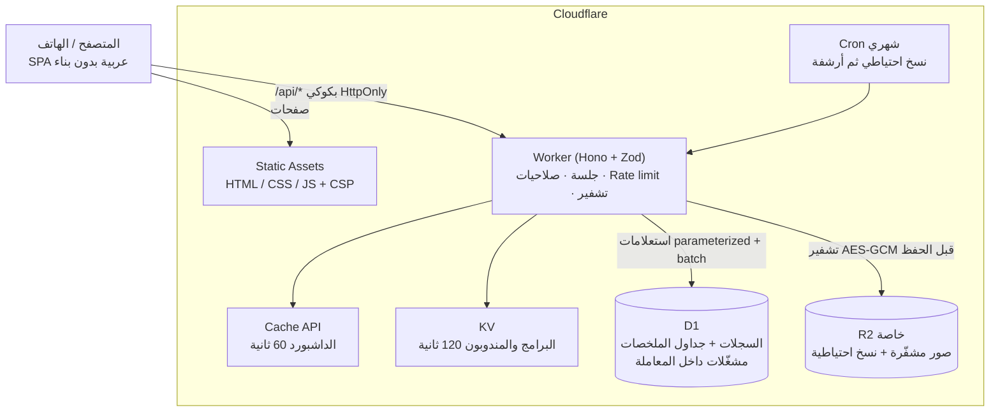
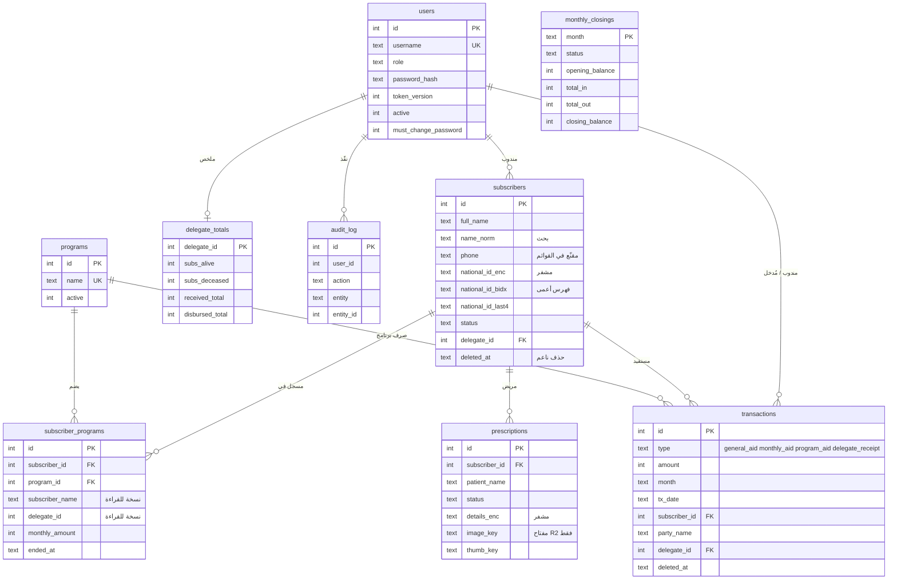

# المعمارية

## المخطط

## مسار الطلب

1. **حماية الطلب:** ترويسة `x-app` وفحص `Origin` للكتابة، مع كوكي `SameSite=Strict`.
2. **الجلسة:** يُتحقق من التوقيع بلا قراءة من D1. يُراجع صف المستخدم فقط بعد مرور نصف عمر التوكن، لذلك يفقد الحساب المعطّل وصوله خلال 15 دقيقة كحد أقصى.
3. **الصلاحية:** `requireRole` لكل مسار، وفلترة `delegate_id` من الجلسة وليس من الطلب.
4. **التحقق:** Zod لكل مدخل، وكل الاستعلامات parameterized.
5. **الكتابة:** `db.batch()` يجمع السجل مع سطر التدقيق في معاملة واحدة، والمشغّلات تحدّث الملخصات داخلها.

## ERD

جداول إضافية: `stats_totals` و`stats_daily` و`stats_monthly` للملخصات، و`transactions_archive` و`prescriptions_archive` و`audit_log_archive` للأرشيف.

## كيف تحقق التصميم أقل استهلاك للصفوف

| الأسلوب | الأثر المقاس عند 25,000 مشترك |
|---|---|
| ترقيم بالمؤشر `id < ?` | الصفحة 21 تقرأ 30 صفاً مثل الصفحة الأولى، أما OFFSET فيقرأ كل ما قبلها |
| ملخصات بالمشغّلات بدل `COUNT(*)` | الداشبورد 8 صفوف بدل 25,000 صف أو أكثر، و0 عند إصابة الذاكرة |
| بحث بنطاق على عمود مطبّع | 30 صفاً كحد أقصى، بدل مسح الجدول عند استخدام `LIKE '%x%'` |
| نسخ الاسم والمندوب إلى السجلات التابعة | لا JOIN في القوائم، فتُقرأ 30 صفاً بدل 60 |
| فهارس جزئية على الصفوف الحية فقط | فهارس أصغر، والأرشفة لا تثقل القوائم |

## قرارات مهمة

- **المشغّلات تدير الملخصات، لا كود التطبيق.** تعمل داخل نفس المعاملة، فلا يمكن لأي مسار نسيانها، ولا يختل الملخص عند فشل الكتابة أو تكرار الحذف.
- **إقفال الشهر مفروض في القاعدة.** المشغّلات ترفض الإضافة والحذف في شهر مقفل مهما كان مصدر الطلب.
- **الحركات المالية لا تُعدّل.** التصحيح يكون بحذف ناعم ثم حركة جديدة، فيبقى الأثر كاملاً في التدقيق.
- **الفهارس محدودة عمداً.** كل فهرس يضيف صفاً مكتوباً لكل عملية إدراج، لذلك وُضع الفهرس حيث يخدم استعلاماً فعلياً فقط، وليس على كل عمود. مثلاً، قائمة الحركات مقيدة بشهر وتستخدم `(type, month, id)` بدل فهرس منفصل على كل عمود.
- **الروابط الموقّعة يصدرها الـ Worker.** لأن الصور مشفّرة في R2 ولا يمكن تقديمها مباشرة. الرابط صالح 5 إلى 10 دقائق ومربوط بالمستخدم، ويتطلب جلسة، وحدود نوافذ ثابتة تجعل المتصفح يعيد استخدام النسخة المخزنة بدل عملية R2 جديدة.
- **البحث عبر POST.** لتبقى الأسماء والهواتف خارج الروابط وسجلات الطلبات.
- **التدقيق يشمل الأحداث الحساسة:** الدخول، كل الكتابات، كشف البيانات، وفتح الوصفة. تصفح القوائم المقنّعة لا يُسجَّل، لأن ذلك يضيف صف كتابة لكل صفحة.
- **PBKDF2 بـ 100,000 تكرار.** هذا الحد الأقصى المتاح في Workers، مع قفل الحساب بعد 5 محاولات فاشلة لمدة 15 دقيقة.
- **WebP مع بديل JPEG.** Safari لا يستطيع إنتاج WebP من canvas، ولو طُبّق الشرط حرفياً لتعذّر الرفع من iPhone.

## التسديد الشهري وسجل المشتركين

- **كل تسديد حركة مالية حقيقية** من نوع `delegate_receipt` مع عمود `period`، فيدخل تلقائياً في الملخصات والإقفال الشهري.
- **الفهرس الفريد** على المشترك والشهر يمنع تسجيل الشهر نفسه مرتين.
- **`subscriber_year`** يحفظ حالات 12 شهراً في عدد واحد، فصفحة من 30 مشتركاً تقرأ نحو 50 صفاً بدل مئات.
- **`delegate_period`** يحفظ ملخص كل شهر لكل مندوب، والصف ذو `delegate_id = 0` يحفظ إجمالي المؤسسة.
- **الجدولان `WITHOUT ROWID`** ليُقرأ كل صف مرة واحدة بدل قراءة الفهرس ثم الجدول.
- **تحديد شهر الإقفال:** شهر الاستلام (`month`) هو الذي يدخل الإقفال، أما `period` فهو الشهر المسدَّد عنه.

## الافتراضات

راجع هذه النقاط، فبعضها يغيّر منطق العمل:

1. **المشتركون لا يسجلون الدخول.** المواصفات ذكرت 4 أدوار فقط، لذلك الدخول للموظفين، مع أن الأرقام المتزامنة (500–1000) تشير إلى احتمال وجود بوابة للمشتركين. لا توجد صفحات لهم حالياً.
2. **«استلام المبالغ» يُعد مقبوضات داخلة للصندوق** يجمعها المندوبون. فالرصيد الختامي = الافتتاحي + استلام المندوبين − المصروفات. إذا كان المقصود مبالغ يسلّمها الصندوق للمندوب ليصرفها، فيجب تغيير معادلة الإقفال.
3. **«[حدد: الأيتام / الكفالة / ...]»** طُبّق كبرامج ديناميكية، مبذورة بـ«الأيتام» و«الكفالة»، ويضيف المدير أي برنامج جديد بلا تعديل برمجي.
4. **المحاسب يرى اسم المستفيد** داخل الحركة المالية، لأن السجل المالي بلا اسم لا معنى له، لكنه لا يرى الهاتف أو الهوية أو سجل المشتركين.
5. **المندوب يكشف هاتف وهوية مشتركيه فقط**، والكشف مسجل في التدقيق. ويسجل تسديدات مشتركيه فقط، ولا يكتب غيرها من الحركات المالية. **إلغاء التسديد للمدير العام وحده.**
6. **المبالغ أعداد صحيحة بلا كسور**، والعملة الافتراضية الدينار العراقي.
7. **الأرشفة تشمل الحركات في الأشهر المقفلة فقط**، والوصفات غير المعلقة، وسجل التدقيق. المشتركون لا يُؤرشفون. والأرشيف محفوظ في جداوله لكن لا توجد له شاشة عرض حالياً.
8. **البحث من بداية الاسم أو الهاتف فقط.** البحث بالاسم الأخير يحتاج جدول كلمات إضافياً يزيد الكتابة.
